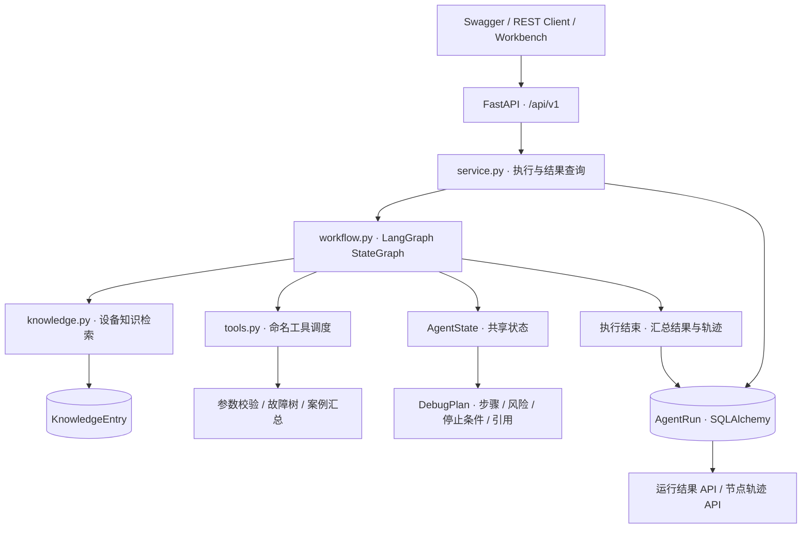
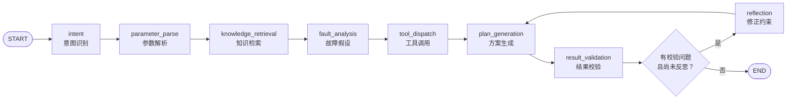
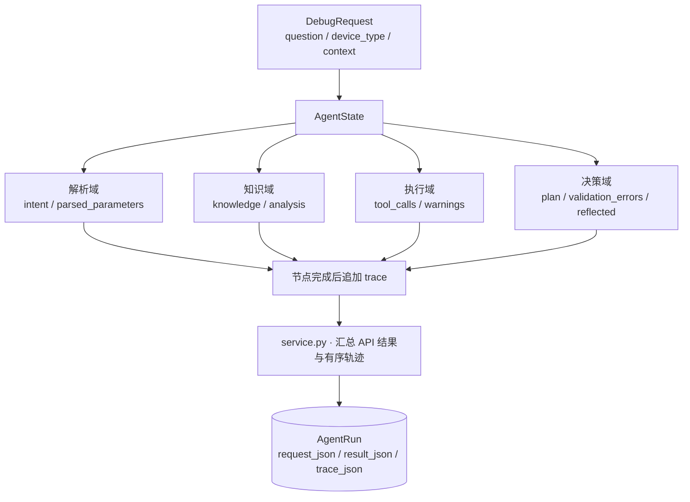
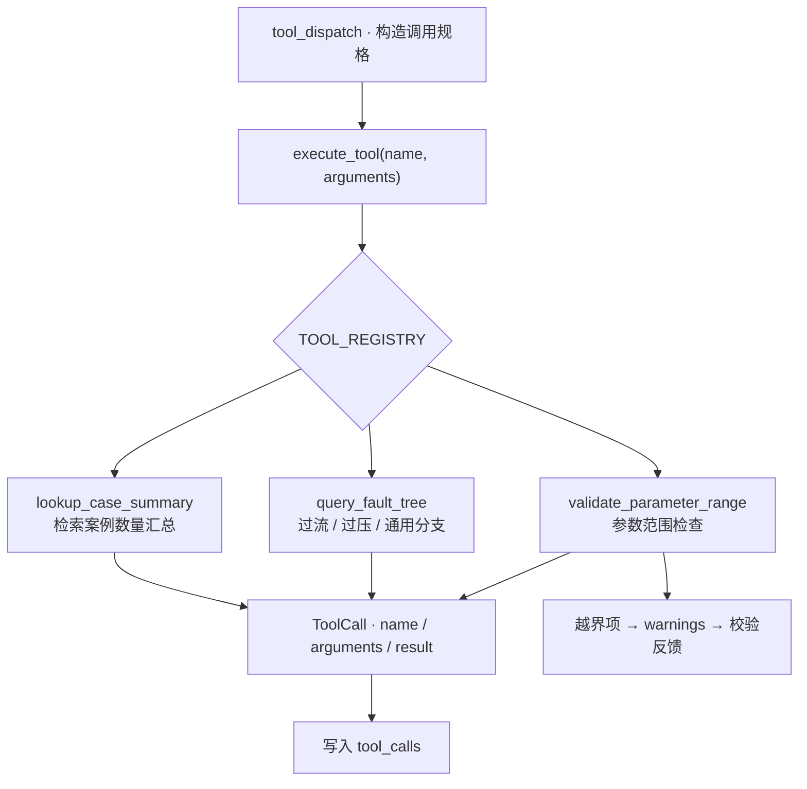
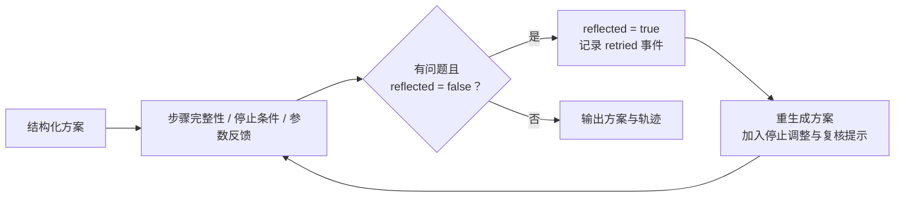
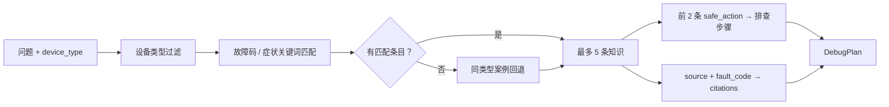

<div align="center">

# Industrial Debugging Agent

**面向工业设备故障研判的多阶段 Agent 编排、工具调用与反思纠错服务**

`FastAPI` · `LangGraph` · `Tool Calling` · `State Management` · `SQLAlchemy`

**Author: Hzhikai** · 基于实际项目经验独立整理 · 开源交流与共同学习

[English](README_EN.md) · [架构设计](docs/architecture.md) · [模块说明](docs/modules.md) · [业务设计](docs/business-design.md) · [API](docs/api.md)

</div>

---

> 本仓库中的公开代码、架构设计与技术文档由 **Hzhikai** 基于本人实际项目经验独立整理并授权发布，用于 LLM 应用开发交流、开源共同学习与求职作品展示。欢迎阅读、引用、讨论和改进，并请保留作者与[许可证](LICENSE)信息。

## 项目定位

工业设备排障往往需要结合问题描述、设备参数、故障案例和检查规则。本项目将这些步骤组织成具有显式状态、工具接口和校验反馈的 LangGraph 工作流，把一次问答转化为可阅读、可追踪、可复核的诊断过程。

工程围绕 **“问题解析 → 知识检索 → 工具执行 → 方案生成 → 校验与修正”** 展开，重点呈现 Agent 控制流设计、状态传递、工具封装与结果持久化。公开版本由作者独立整理，以通用设备知识和平台无关接口呈现工程设计。

## 核心能力

| 技术方向 | 具体实现 | 源码入口 |
| --- | --- | --- |
| LangGraph 编排 | 7 个主流程节点、1 个反思节点、显式边与条件路由 | [workflow.py](app/workflow.py) |
| 状态管理 | TypedDict 状态模型、节点增量更新、上下文参数覆盖 | [AgentState](app/workflow.py) |
| 参数理解 | 中英文电压、电流、频率、温度名称及数值、单位提取 | [参数解析](app/workflow.py) |
| 知识增强 | 设备类型过滤、故障码与症状匹配、同类案例回退、引用关联 | [knowledge.py](app/knowledge.py) |
| 工具调用 | 命名注册表、统一调度入口、参数范围检查、故障树查询、案例汇总 | [tools.py](app/tools.py) |
| 反思纠错 | 步骤与停止条件检查、越界参数反馈、一次有界重生成 | [条件路由](app/workflow.py) |
| 工程接口 | Pydantic 数据契约、FastAPI/OpenAPI、统一业务错误响应 | [main.py](app/main.py) · [schemas.py](app/schemas.py) |
| 过程追踪 | UUID 运行记录、工具输入输出、节点顺序/状态/摘要、结果回查 | [service.py](app/service.py) |

## 系统架构



详细分层与调用边界见 [架构设计](docs/architecture.md)。

## 关键业务设计

### 1. LangGraph：把诊断过程组织成显式状态图

`build_workflow(db)` 注册节点与边，并通过 `compile()` 构建执行图。常规链路由七个阶段组成，校验节点通过条件边决定结束或进入反思分支，使执行顺序与纠错路径都能直接对应到代码。



- **显式控制流**：主流程节点与异常分支分别建模，阅读图即可定位执行阶段。
- **条件反馈**：以 `validation_errors` 和 `reflected` 决定分支，反思后回到方案生成与校验。
- **有界纠错**：通过状态标志将反思限制为一次，避免同一请求反复循环。

源码入口：[状态图与节点函数](app/workflow.py) · [工作流调用](app/service.py)

### 2. 状态管理：业务上下文、知识证据与执行轨迹统一传递

`AgentState` 使用 `TypedDict` 描述共享字段，各节点返回需要更新的状态片段。参数解析把问题中的自然语言字段归一化，再合并 `context.parameters`，让结构化输入优先于文本提取值。



- **状态分域**：输入、解析、知识、工具、方案和轨迹各有清晰字段。
- **增量更新**：节点返回局部状态，减少跨阶段传参的耦合。
- **运行可回查**：执行结束后保存请求、公开结果字段和节点事件，按 `run_id` 读取。

源码入口：[AgentState](app/workflow.py) · [数据契约](app/schemas.py) · [运行记录模型](app/db/models.py)

### 3. 工具调用：注册、调度与结果记录分离

工具遵循 `dict → dict` 的统一函数接口，由 `TOOL_REGISTRY` 维护名称与函数的映射。工作流构造调用规格，再由 `execute_tool(name, arguments)` 分发，统一记录工具名称、入参与结果。



- **接口统一**：工具实现与图节点分离，新增工具可沿用同一注册与调用方式。
- **执行透明**：API 保留工具输入输出，便于复核参数来源及规则结果。
- **职责明确**：参数检查提供风险反馈，故障树提供排查分支，案例汇总提供检索数量。

源码入口：[工具注册与实现](app/tools.py) · [调度节点](app/workflow.py) · [ToolCall 模型](app/schemas.py)

### 4. 反思纠错：把校验反馈转化为更保守的方案

结果校验检查方案步骤数量、停止条件及参数越界反馈。首次发现校验问题时，条件边进入 `reflection`，将 `reflected` 置为真并记录 `retried` 事件；方案节点据此增加停止调整、人工复核的约束，再执行校验。



- **反馈驱动**：由校验结果触发修正，而非无条件重复生成。
- **风险保留**：参数越界警告继续保留在结果中，对应高风险方案标识。
- **建议可复核**：`DebugPlan` 包含步骤、风险级别、停止条件和知识引用，便于人工审阅。

源码入口：[校验、反思与路由](app/workflow.py) · [DebugPlan](app/schemas.py)

### 5. 知识增强：把故障案例关联到排查步骤

知识条目以设备类型、故障码、症状、可能原因、安全动作和来源组织。检索先限定设备类型，再按提取的字母/数字关键词匹配故障码与症状；无命中时回退到同类型条目，最多读取五条。方案采用前两条知识的安全动作，并携带检索条目的来源引用。



源码入口：[知识检索](app/knowledge.py) · [KnowledgeEntry](app/db/models.py) · [知识到方案的映射](app/workflow.py)

## 源码导航

```text
industrial-debugging-agent/
├── app/
│   ├── main.py           # FastAPI 路由、生命周期与依赖注入
│   ├── workflow.py       # AgentState、节点、条件边与反思分支
│   ├── tools.py          # 工具注册表、参数检查与故障树
│   ├── knowledge.py      # 故障案例管理与检索
│   ├── service.py        # 工作流执行、结果与轨迹持久化
│   ├── schemas.py        # 请求、方案、工具和轨迹数据契约
│   ├── core/             # 环境配置与统一业务错误
│   └── db/               # SQLAlchemy 模型与会话管理
├── docs/                 # 架构、模块、业务导读与 API
├── examples/             # 调试请求、反思场景与知识条目
├── tests/                # API 与工作流测试源码
├── pyproject.toml        # 依赖与工具配置
└── *.ps1                 # Windows 安装、启动与管理脚本
```

## API 契约

| 方法与路径 | 用途 |
| --- | --- |
| `GET /api/v1/health` | 服务状态与运行记录计数 |
| `POST /api/v1/runs` | 执行工作流，返回方案、工具结果和节点轨迹 |
| `GET /api/v1/runs/{run_id}` | 按 UUID 回查结果 |
| `GET /api/v1/runs/{run_id}/trace` | 读取有序节点事件 |
| `POST /api/v1/knowledge/cases` | 新增结构化知识条目 |

接口模型由 Pydantic 定义，Swagger 与 OpenAPI 分别位于 `/docs`、`/openapi.json`。字段说明与 PowerShell 调用示例见 [API 文档](docs/api.md)。

## 本地使用

环境：**Python 3.12 / 3.13 + PowerShell**，依赖范围见 [pyproject.toml](pyproject.toml)。

```powershell
git clone https://github.com/Kailovek/industrial-debugging-agent.git
cd industrial-debugging-agent
Copy-Item .env.example .env
.\setup.ps1
.\start.ps1
```

打开 `http://127.0.0.1:8102/docs`，或提交 [调试请求](examples/debug_request.json)：

```powershell
$body = Get-Content -LiteralPath .\examples\debug_request.json -Raw -Encoding UTF8
$run = Invoke-RestMethod -Method Post -Uri "http://127.0.0.1:8102/api/v1/runs" `
    -ContentType "application/json; charset=utf-8" -Body ([Text.Encoding]::UTF8.GetBytes($body))
$run.plan
$run.tool_calls
$run.trace | Format-Table node, status, summary
```

[反思场景请求](examples/reflection_request.json)便于阅读参数越界后的分支设计。结束使用时运行 `.\stop.ps1`。本地配置放入 `.env`，凭据、数据库文件和运行日志由 `.gitignore` 排除。

## 作者与开源

- **Hzhikai**：公开工程设计、核心实现与技术文档，见 [AUTHORS.md](AUTHORS.md)。
- 自有代码与文档采用 [MIT License](LICENSE)，依赖版权见 [THIRD_PARTY_NOTICES.md](THIRD_PARTY_NOTICES.md)。
- 公开模块与阅读方式见 [PUBLICATION_SCOPE.md](PUBLICATION_SCOPE.md)。

欢迎围绕 Agent 编排、工具接口和反思机制交流、引用与改进。方案用于虚拟设备的诊断交流与人工复核；实际设备作业应遵循原厂规范和具备资质人员的审核。
