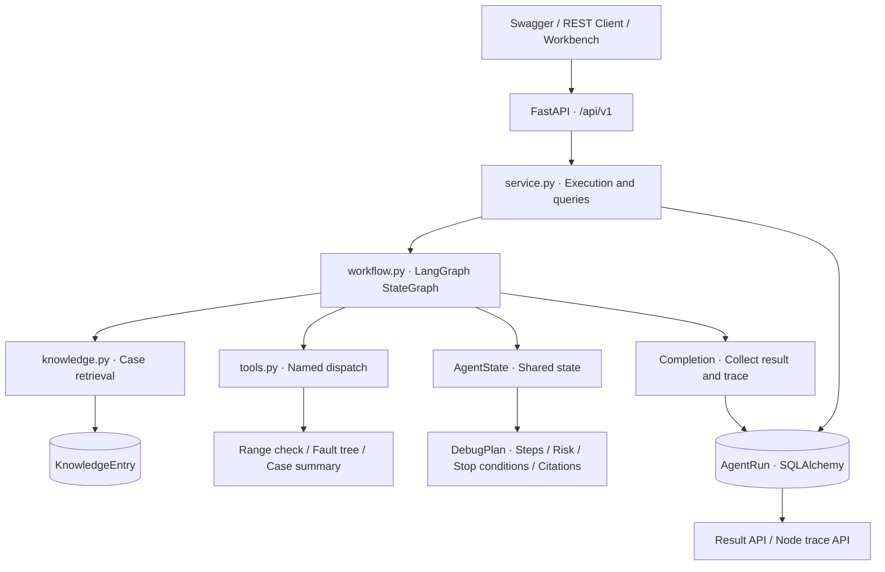
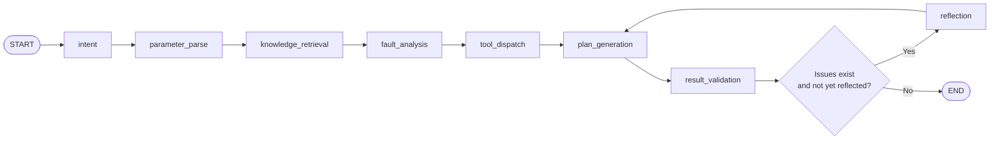
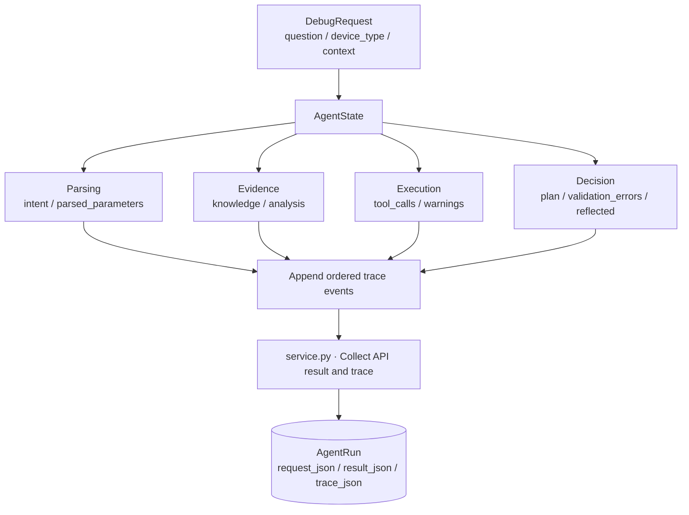
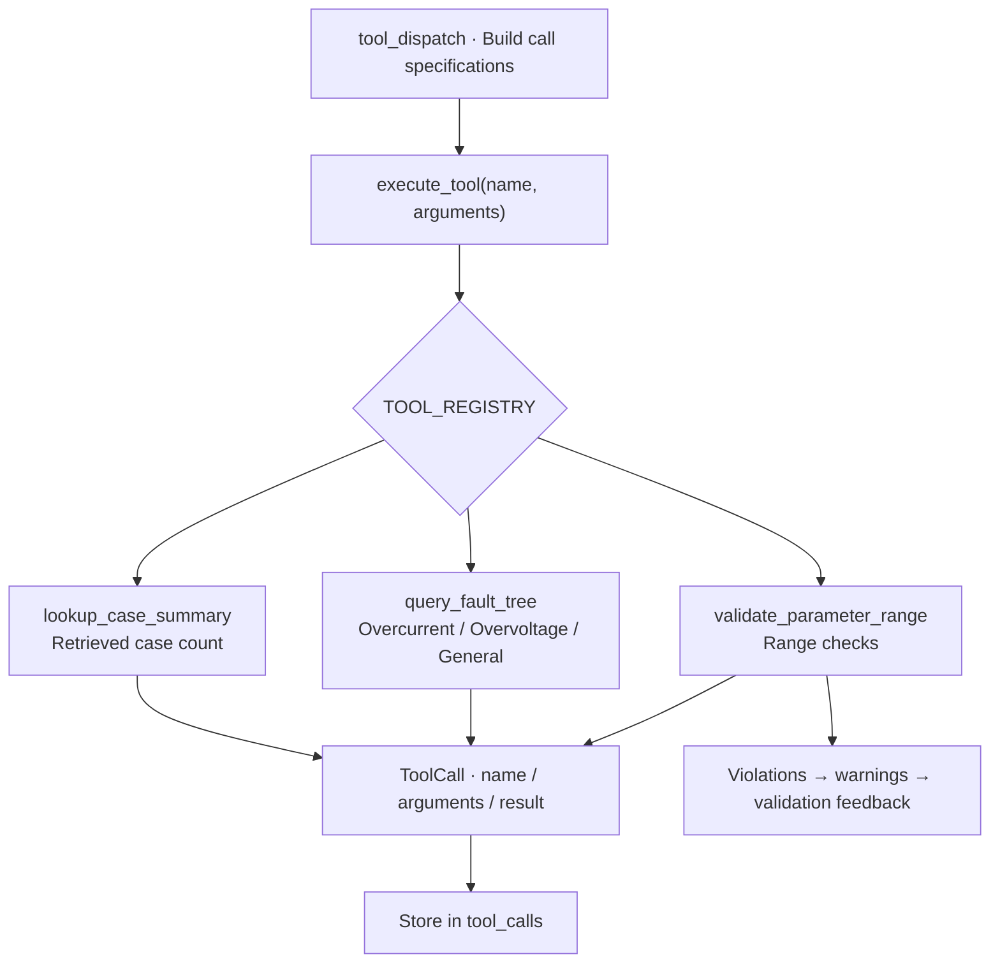
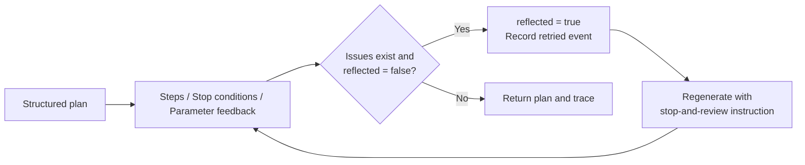
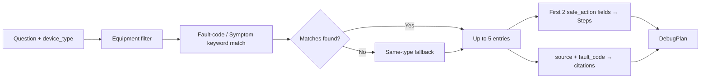

<div align="center">

# Industrial Debugging Agent

**Multi-stage troubleshooting workflows with explicit state, tool calls and bounded reflection**

`FastAPI` · `LangGraph` · `Tool Calling` · `State Management` · `SQLAlchemy`

**Author: Hzhikai** · Independently organized from practical project experience · Open collaboration and shared learning

[中文](README.md) · [Architecture](docs/architecture.md) · [Modules](docs/modules.md) · [Business design](docs/business-design.md) · [API](docs/api.md)

</div>

---

> The public code, architecture and technical documentation in this repository are independently organized and authorized for publication by **Hzhikai**, based on personal project experience, for LLM application development, open collaboration, shared learning and portfolio presentation. Reading, citation, discussion and improvements are welcome. Please retain the author and [license](LICENSE) notices.

## Overview

Industrial troubleshooting combines a problem description, equipment parameters, reference cases and diagnostic rules. This project expresses those steps as a LangGraph workflow with explicit state, named tools and validation feedback, making the diagnostic process readable, traceable and reviewable.

The engineering focus is **problem parsing → knowledge retrieval → tool execution → plan generation → validation and correction**. The independently organized public implementation presents workflow control, state propagation, tool boundaries and result persistence through generic equipment knowledge and platform-independent interfaces.

## Capabilities

| Area | Implementation | Source |
| --- | --- | --- |
| LangGraph orchestration | Seven main stages, one reflection node, explicit edges and conditional routing | [workflow.py](app/workflow.py) |
| State management | TypedDict state, incremental node updates, context parameter overrides | [AgentState](app/workflow.py) |
| Parameter parsing | Chinese/English voltage, current, frequency and temperature names, values and units | [Parsing](app/workflow.py) |
| Knowledge augmentation | Equipment filtering, fault-code/symptom matching, same-type fallback and citations | [knowledge.py](app/knowledge.py) |
| Tool calling | Named registry, common dispatcher, range checks, fault-tree lookup and case counts | [tools.py](app/tools.py) |
| Reflection | Step/stop-condition validation, parameter feedback and one bounded regeneration | [Routing](app/workflow.py) |
| API engineering | Pydantic contracts, FastAPI/OpenAPI and structured business errors | [main.py](app/main.py) · [schemas.py](app/schemas.py) |
| Inspectability | UUID run records, tool arguments/results, ordered node events and result queries | [service.py](app/service.py) |

## Architecture



See [architecture](docs/architecture.md) for layer responsibilities and call boundaries.

## Key designs

### 1. LangGraph: explicit diagnostic control flow

`build_workflow(db)` registers nodes and edges, then calls `compile()`. The normal path has seven stages. A conditional edge after validation either ends execution or enters reflection, keeping both the main sequence and correction path visible in code.



- **Explicit control flow:** separate nodes and edges describe each stage and its feedback path.
- **State-based routing:** `validation_errors` and `reflected` select the branch.
- **Bounded correction:** one reflection pass returns to generation and validation.

Source: [Graph and node functions](app/workflow.py) · [Invocation](app/service.py)

### 2. State management: context, evidence and trace

`AgentState` is a `TypedDict`; each node returns the fields it updates. Parameter parsing canonicalizes textual fields, then merges `context.parameters`, giving structured input precedence over extracted values.



- **Separated concerns:** input, evidence, tool outcomes, decisions and trace have explicit fields.
- **Incremental updates:** node outputs update shared state without long argument chains.
- **Queryable records:** the completed request, public result fields and trace are persisted under a `run_id`.

Source: [AgentState](app/workflow.py) · [Contracts](app/schemas.py) · [Persistence models](app/db/models.py)

### 3. Tool calling: registration, dispatch and recording

Tools share a `dict → dict` function contract. `TOOL_REGISTRY` maps names to functions; the workflow constructs call specifications and invokes `execute_tool(name, arguments)`. Each call records its name, arguments and result.



- **Common interface:** tool implementations are separated from graph nodes.
- **Inspectable execution:** tool arguments and results remain available in API responses.
- **Focused responsibilities:** range checking supplies risk feedback, fault-tree lookup supplies diagnostic branches, and case summaries supply retrieval counts.

Source: [Registry and tools](app/tools.py) · [Dispatch node](app/workflow.py) · [ToolCall](app/schemas.py)

### 4. Reflection: turn validation feedback into a conservative plan

Validation checks step count, stop conditions and parameter feedback. On the first detected issue, the reflection branch sets `reflected`, appends a `retried` event and returns to plan generation. The regenerated plan adds a stop-and-review instruction before validation runs again.



- **Feedback-driven correction:** validation selects the correction path.
- **Retained risk context:** parameter warnings remain in the result and produce a high-risk classification.
- **Reviewable advice:** `DebugPlan` includes steps, risk level, stop conditions and citations.

Source: [Validation, reflection and routing](app/workflow.py) · [DebugPlan](app/schemas.py)

### 5. Knowledge augmentation: link reference cases to steps

Knowledge entries contain equipment type, fault code, symptom, probable cause, safe action and source. Retrieval filters by equipment type and uses extracted alphanumeric terms to match fault codes and symptoms. If no match is found, it falls back to same-type entries, returning up to five cases. The plan uses safe actions from the first two entries and includes source references.



Source: [Retrieval](app/knowledge.py) · [KnowledgeEntry](app/db/models.py) · [Plan assembly](app/workflow.py)

## Source map

```text
industrial-debugging-agent/
├── app/
│   ├── main.py           # Routes, lifecycle and dependency injection
│   ├── workflow.py       # State, nodes, edges and reflection
│   ├── tools.py          # Registry, range checks and fault tree
│   ├── knowledge.py      # Case management and retrieval
│   ├── service.py        # Execution, results and trace persistence
│   ├── schemas.py        # Request, plan, tool and trace contracts
│   ├── core/             # Settings and business errors
│   └── db/               # SQLAlchemy models and sessions
├── docs/                 # Architecture, modules, design guide and API
├── examples/             # Debug requests and knowledge entry
├── tests/                # API and workflow test sources
├── pyproject.toml        # Dependencies and tool settings
└── *.ps1                 # Windows setup and service scripts
```

## API contract

| Method and path | Purpose |
| --- | --- |
| `GET /api/v1/health` | Service status and run count |
| `POST /api/v1/runs` | Execute workflow; return plan, tools and trace |
| `GET /api/v1/runs/{run_id}` | Retrieve a result by UUID |
| `GET /api/v1/runs/{run_id}/trace` | Read ordered node events |
| `POST /api/v1/knowledge/cases` | Add a structured knowledge entry |

Pydantic defines the API models. Swagger UI and OpenAPI are available at `/docs` and `/openapi.json`. See [API documentation](docs/api.md) for fields and PowerShell examples.

## Local usage

Environment: **Python 3.12 / 3.13 + PowerShell**. Dependency ranges are defined in [pyproject.toml](pyproject.toml).

```powershell
git clone https://github.com/Kailovek/industrial-debugging-agent.git
cd industrial-debugging-agent
Copy-Item .env.example .env
.\setup.ps1
.\start.ps1
```

Open `http://127.0.0.1:8102/docs` or submit the [debug request](examples/debug_request.json):

```powershell
$body = Get-Content -LiteralPath .\examples\debug_request.json -Raw -Encoding UTF8
$run = Invoke-RestMethod -Method Post -Uri "http://127.0.0.1:8102/api/v1/runs" `
    -ContentType "application/json; charset=utf-8" -Body ([Text.Encoding]::UTF8.GetBytes($body))
$run.plan
$run.tool_calls
$run.trace | Format-Table node, status, summary
```

The [reflection request](examples/reflection_request.json) illustrates the parameter-feedback branch. Use `.\stop.ps1` to stop the service. Keep local settings in `.env`; credentials, databases and runtime logs are excluded by `.gitignore`.

## Author and license

- **Hzhikai:** public architecture, core implementation and technical documentation. See [AUTHORS.md](AUTHORS.md).
- Original code and documentation are released under the [MIT License](LICENSE). Dependency notices are in [THIRD_PARTY_NOTICES.md](THIRD_PARTY_NOTICES.md).
- Published modules and reading guidance are listed in [PUBLICATION_SCOPE.md](PUBLICATION_SCOPE.md).

Discussion, citation and improvements around orchestration, tools and reflection are welcome. Plans support virtual-equipment diagnosis and human review; actual equipment operations require manufacturer procedures and qualified review.
