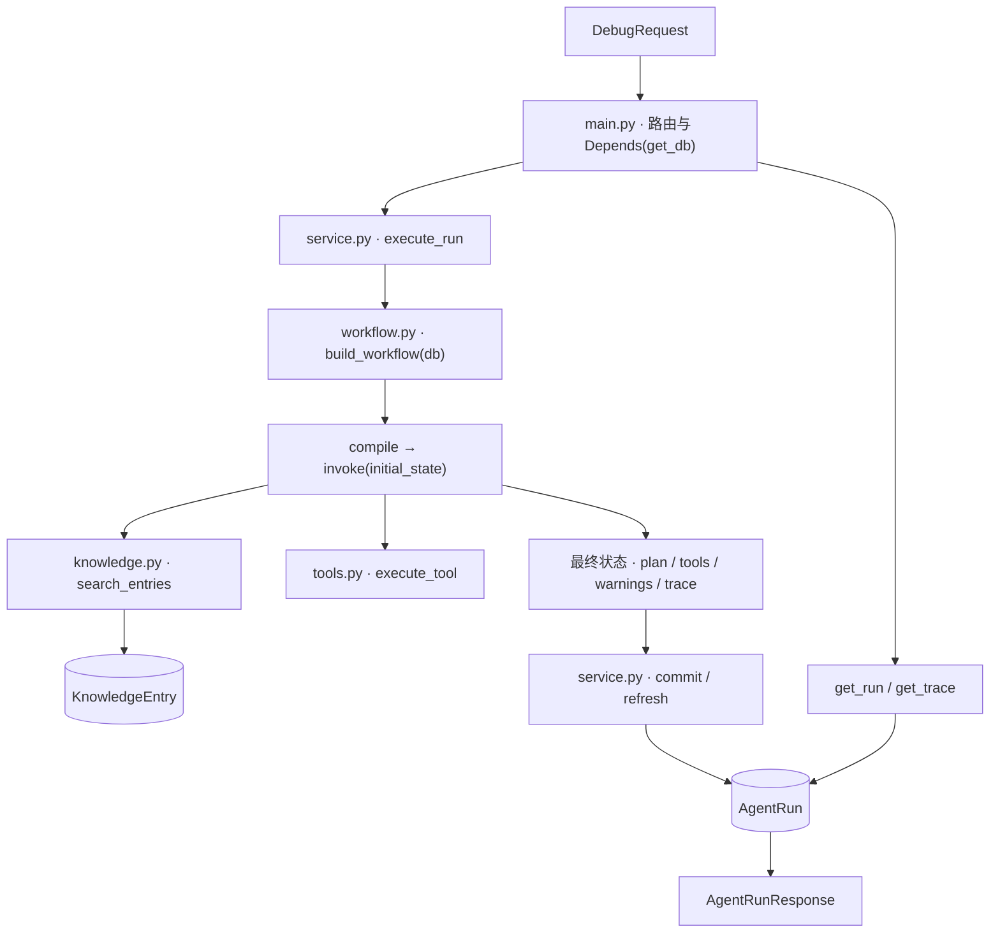
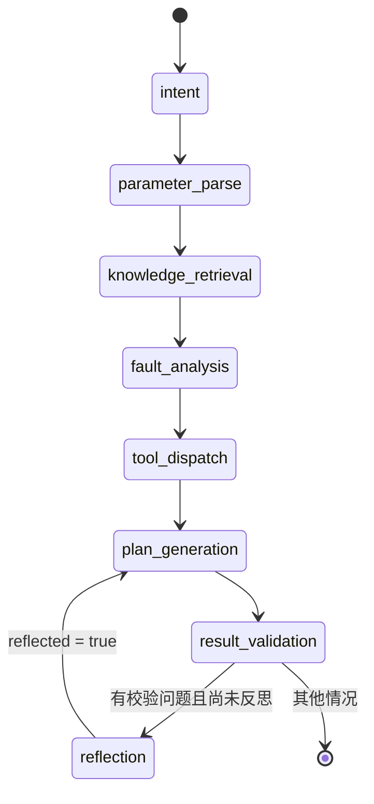

# 系统架构与执行边界

[返回首页](../README.md) · [模块说明](modules.md) · [业务导读](business-design.md) · [API](api.md)

## 分层与调用关系

| 层 | 职责 | 边界 |
| --- | --- | --- |
| API | 请求模型、UUID 路由、会话注入、响应序列化 | 调用应用服务，不直接编排节点 |
| 应用服务 | 构图、执行、结果汇总、运行记录读写 | 每次请求构建并调用工作流 |
| 工作流 | 状态更新、节点顺序、条件反馈 | 知识检索委托给 knowledge，工具执行委托给 tools |
| 知识与工具 | 查询故障条目、参数检查、故障树、案例汇总 | 使用明确的函数接口 |
| 数据层 | 知识记录、运行请求、结果和轨迹 | SQLAlchemy 模型与会话 |

## LangGraph 节点关系

意图分类写入状态与响应；工具调用规格由 `tool_dispatch` 构造。条件路由集中在结果校验之后，依据 `validation_errors` 与 `reflected` 选择分支。

## 状态生命周期

1. `DebugRequest` 提供问题、设备类型和上下文。
2. 应用服务初始化 `warnings=[]`、`trace=[]`、`reflected=False`。
3. 节点以字典返回增量更新；`_event` 将新的摘要事件追加到已有轨迹。
4. `workflow.invoke()` 完成后，服务提取响应字段并写入运行记录。
5. 结果与轨迹分别通过查询接口按 UUID 读取。

`analysis` 是故障假设节点写入的运行态字段；方案生成读取 `knowledge`、`warnings` 与 `reflected`。持久化内容由应用服务显式选择，见下表。

| 保存位置 | 内容 |
| --- | --- |
| `request_json` | 完整请求模型 |
| `result_json` | intent、device_type、parsed_parameters、plan、tool_calls、warnings |
| `trace_json` | 各事件的 node、status、summary |
| 关系字段 | id、status、created_at |

## API 执行语义

`POST /runs` 在当前请求内执行工作流并保存结果，随后返回 `202` 与完整 `AgentRunResponse`。结果查询用于回看已保存记录，轨迹接口提供执行结束后的有序节点摘要。

节点事件描述阶段、状态和摘要；工具记录保存实际调用参数与返回值。两者共同支持过程阅读与前端展示。

## 数据设计

- `KnowledgeEntry`：UUID 主键；`device_type` 与 `fault_code` 分别建立索引；保存症状、可能原因、安全动作与来源。
- `AgentRun`：UUID 主键；保存状态、请求 JSON、结果 JSON、轨迹 JSON 与 UTC 创建时间。
- 数据库会话通过 FastAPI 依赖注入进入请求，工作流复用该会话检索知识，结束后由应用服务提交运行记录。

## 诊断建议边界

参数范围表是通用化诊断规则，设备规则应由具备资质人员根据原厂资料确定。工作流输出排查建议、风险标识和停止条件，面向虚拟设备与人工复核场景。
