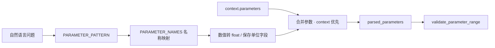
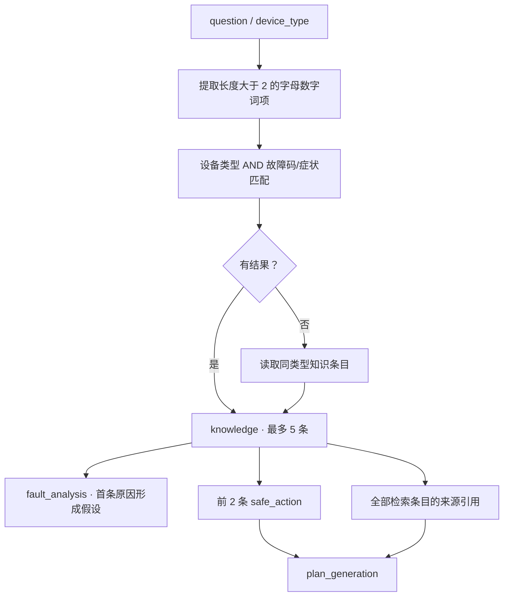
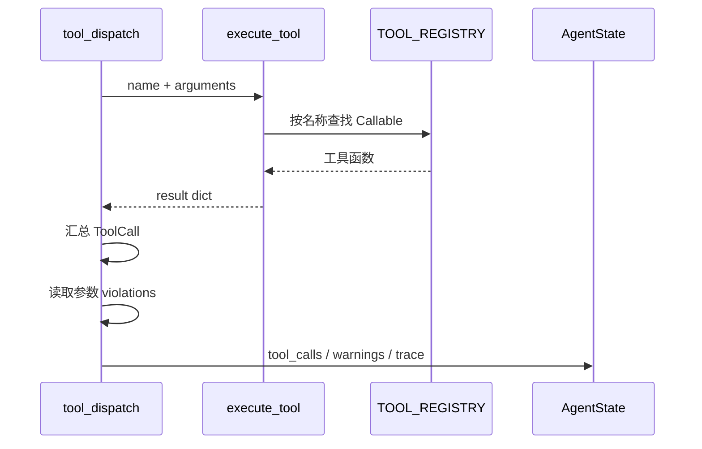
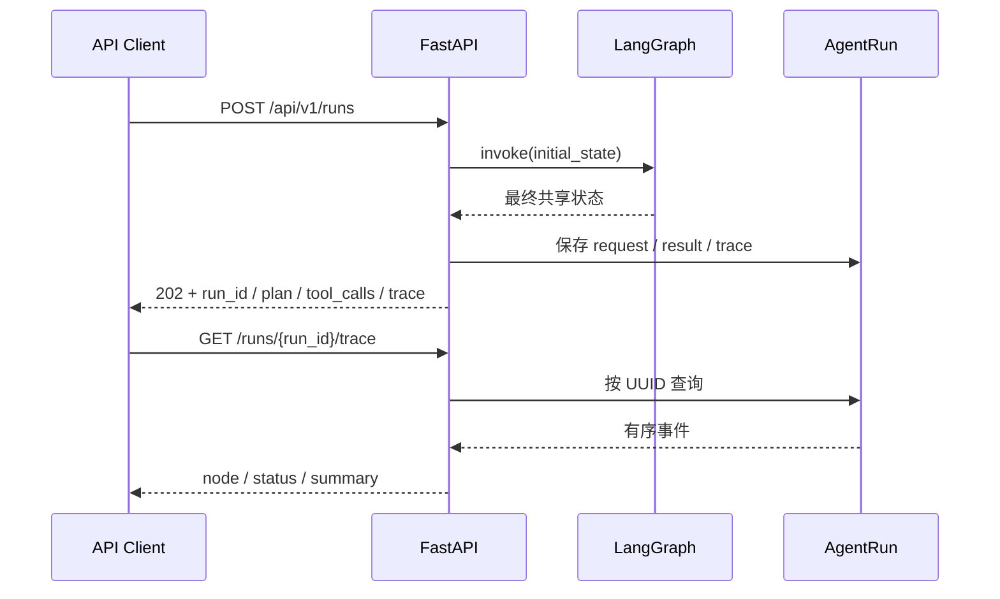

# Agent 工程化设计导读

[返回首页](../README.md) · [架构设计](architecture.md) · [API](api.md)

## 1. 从问题到统一参数

参数解析使用中英文名称映射，将 voltage / 电压等名称归一化为统一字段，提取数值和可选单位。随后合并 `context.parameters`，同名字段以结构化上下文为准。



设计关注点是输入归一化与优先级规则。通用范围按字段约定的单位解释，数值范围规则与名称解析分别定义在工具层和工作流层。

## 2. 检索证据如何进入方案

检索使用 `device_type` 约束知识范围，再对提取的字母/数字词项执行故障码与症状匹配；没有匹配结果时，读取同类型案例。每次最多五条。



知识引用格式为 `[source:fault_code]`。知识条目的安全动作形成建议步骤；工具范围反馈形成风险警告，两类输入在方案生成阶段承担不同职责。

## 3. 工具调用契约

工作流在 `tool_dispatch` 中构造三项调用规格，并按顺序交给注册表调度。每项调用记录名称、参数和结果，便于将工具执行过程与用户可读方案分开展示。



扩展工具时，先定义清晰的字典入参和返回字段，再注册函数，并在节点中提供调用规格。该边界让工具实现与图结构保持分离。

## 4. 校验—反思—重生成

`result_validation` 检查步骤数量、停止条件和需要反思的参数反馈。路由规则为：

```text
validation_errors 非空 且 reflected 为 false → reflection
其他情况 → END
```

反思节点设置标志并记录 `retried`。方案生成节点读取该标志，在安全状态步骤之后增加停止调整与专业复核提示。再次校验后按同一路由规则结束，参数警告继续保留。

| 状态字段 | 用途 |
| --- | --- |
| validation_errors | 当前校验问题 |
| reflected | 限制单次请求的反思次数 |
| warnings | 保留参数风险反馈 |
| trace | 记录回路经过的节点、状态与摘要 |

这是针对规则反馈的有界修正设计，重点在于可解释条件、保留风险和明确停止行为。

## 5. 运行记录与过程查看



## 6. 场景阅读

以下文件为接口输入示例，适合对照分支条件阅读源码：

- [debug_request.json](../examples/debug_request.json)：问题描述中的电流与频率，加上结构化上下文中的电压。
- [reflection_request.json](../examples/reflection_request.json)：电压输入超过通用范围，用于理解校验反馈及反思路径。
- [knowledge_case.json](../examples/knowledge_case.json)：结构化知识条目的字段关系。

推荐讲解顺序：状态图说明控制流，状态表说明数据流，工具注册表说明扩展边界，反思条件说明纠错设计，运行记录说明可观测性。
